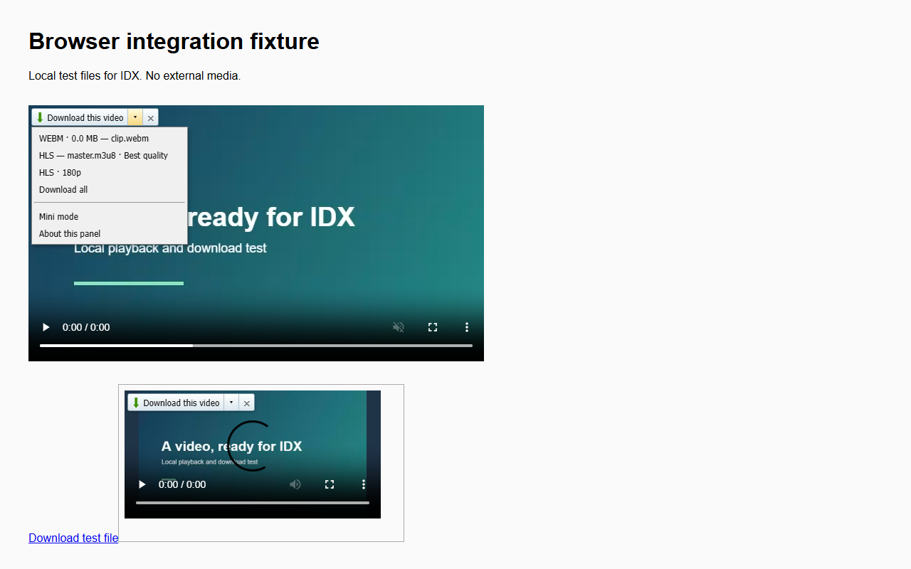

# IDX - Internet Downloader X

IDX is an **open-source alternative to Internet Download Manager, rewritten in Rust** for Windows. Download files faster with multiple connections, pause and resume transfers, and keep everything organised with queues, schedules and categories. The Chrome extension lets you send downloads to IDX and pick a video quality straight from the player.

**[Download for Windows](https://github.com/itsParassharma/IDX-Internet-Downloader-X/releases/latest)** | [Chrome extension](https://chromewebstore.google.com/detail/bokfgodnpemfnmflphpcoccandblongm) | [Report a problem](https://github.com/itsParassharma/IDX-Internet-Downloader-X/issues)

## What you can do

- **Pause and pick up later.** Resume supported downloads without starting over.
- **Download several files at once.** Set connection limits, retry interrupted transfers and check files with SHA-256.
- **Keep downloads organised.** Sort files into categories with their own folders and rules.
- **Choose when to download.** Add files to a queue or schedule them for later.
- **Grab video and audio.** Use the Chrome player menu to choose a quality, download detected files together or switch to a smaller panel.
- **Collect links from a page.** Filter the results and add the files you want.

## Get started

Download **IDX-Setup-0.7.0.exe** from the [latest release](https://github.com/itsParassharma/IDX-Internet-Downloader-X/releases/latest), run it, then open IDX. Click **Add URL**, paste a link and choose where to save it.

You can also download **IDX-0.7.0-portable.zip**, extract the whole folder and run `idx.exe`.

For browser downloads, add the [Chrome extension](https://chromewebstore.google.com/detail/bokfgodnpemfnmflphpcoccandblongm) and open IDX once. Right-click a link and choose **Download with IDX**, or use the download menu above a video.

## Chrome extension

Choose a video quality from the dropdown without leaving the page.

## Build from source

The app and browser host are written in Rust. The extension uses JavaScript. Build instructions, current feature support and development notes are in the [source guide](source/README.md).

## License

New IDX code is [MIT licensed](LICENSE). Reused UI resources and bundled dependencies retain their own licenses and [notices](RESOURCE-NOTICE.txt). See the [privacy policy](PRIVACY.md) for how downloads and browser data are handled.

IDX is an independent project and is not affiliated with the publisher of Internet Download Manager.
