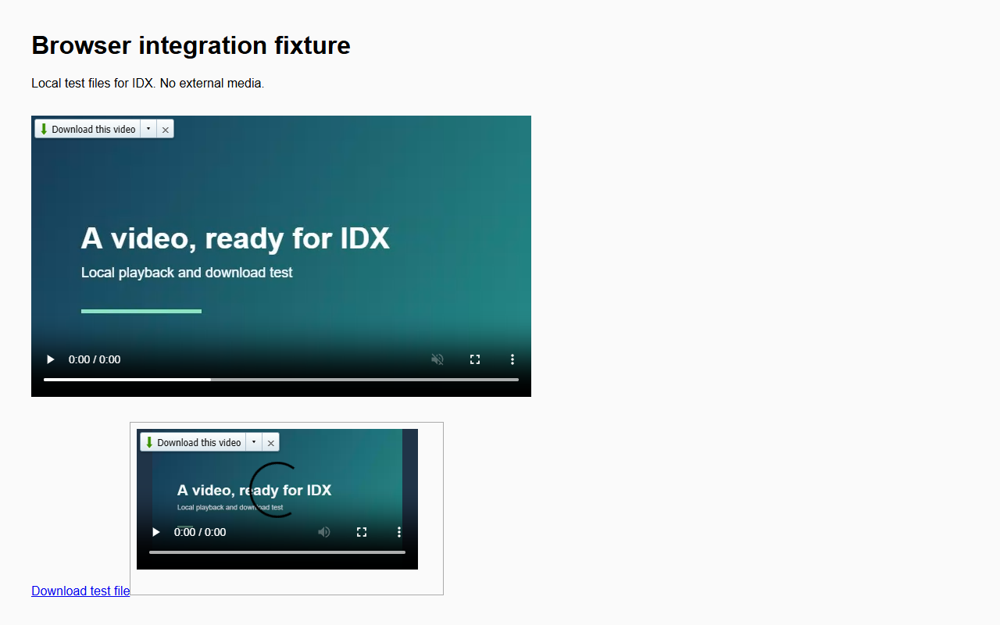

# IDX — Internet Downloader X

IDX is an **open-source alternative to Internet Download Manager, rewritten in Rust** for Windows. Download files with several connections, pause and resume transfers, organise them into queues, and choose video quality straight from Chrome. No account, activation key or trial countdown. IDX is an independent project, and the full migration is still in progress.

**[Download the latest Windows installer](https://github.com/itsParassharma/IDX/releases/latest)** · [Report a problem](https://github.com/itsParassharma/IDX/issues) · [Privacy](PRIVACY.md)

## Get started

1. Open the latest release and download **IDX-Setup-0.7.0.exe**.
2. Run the installer, then open IDX. The installer works for your Windows user without requiring an administrator account.
3. Click **Add URL** to start a download. Choose **Download later** if you want to queue it instead.

Prefer a ZIP? Download **IDX-0.7.0-portable.zip**, extract it, and run `idx.exe`. Keep the native host and `media-tools` folder alongside it. Settings and the download library still live in `%LOCALAPPDATA%\IDX`.

## A little less downloading by hand

- **Parallel downloads:** HTTP and HTTPS transfers with retries, pause/resume and optional SHA-256 verification.
- **Queues and schedules:** group files, choose how many run together, and set weekly or one-time schedules. IDX needs to be running when a schedule starts.
- **Folders that make sense:** categories with file-extension and site rules, plus a folder for each category.
- **Chrome handoff:** automatically send eligible browser downloads to IDX. Chrome continues the download if IDX cannot accept it.
- **Video and audio:** use the small player panel for direct media, completed HLS and static DASH. Choose a quality or download the detected files together.
- **Link grabber:** scan HTML pages, filter the results, and add the files you want.

## Screenshots

These are real screenshots of the bundled extension running in Chromium on a local demonstration page.




## Connect Chrome

Open IDX once so it registers the local browser connection. The release includes the extension in `browser-extension/chromium`. Until the Web Store listing is approved, load that folder through Chrome's **Extensions → Developer mode → Load unpacked**. Refresh any pages that were already open.

The release is configured for Store item `bokfgodnpemfnmflphpcoccandblongm`; nobody needs to copy an extension ID. The Store listing's publication status is separate from this GitHub release.

Click the toolbar icon to enable or disable IDX on the current tab. Open the extension's **Options** for connection checks, automatic capture, panel preferences and site exclusions. Right-click a direct link for **Download with IDX**.

## What to expect

This is an early release, not a finished one-for-one port. FTP/FTPS, live stream recording, DRM, multi-period DASH, HLS discontinuities, tray integration and original IDM database import are still missing. A `blob:` address alone is not a downloadable file. Site-specific token extraction is not supported.

The earlier 0.7.0 build passed 132 Rust tests, 97 extension checks and real Chromium download acceptance. This publication rebuild changes the public extension identity. Its current run passed 129 Rust checks; three checks could not use Windows credential encryption in the restricted build session. See the [publication validation record](source/docs/PUBLICATION-VALIDATION.md) for exact results and the [feature matrix](source/docs/FEATURE-PARITY.md) for remaining work. Full original visual and function-level equivalence has not been established.

## Build it

The application and native browser host are Rust; the browser extension uses JavaScript. On Windows x64, install Rust 1.88 or newer and the Visual Studio C++ build tools with a Windows SDK, then run:

```powershell
cd source
cargo fmt --all -- --check
cargo test --locked
cargo build --release --locked --bins
```

The executables appear in `source/target/release`. For media assembly, run `python tools/fetch_media_tools.py` from `source` and keep the resulting `media-tools` folder beside the executables. That script downloads the pinned LGPL helper and checks its hashes. See the [source guide](source/README.md) for the layout, packaging tools and detailed usage. Replaying the original-resource audit also needs the separately supplied reference files; those are retained in the development workspace.

## License and credits

New IDX code and original documentation are [MIT licensed](LICENSE). Reused native UI templates and artwork retain their original provenance and copyright and are **not covered by that MIT grant**. See [RESOURCE-NOTICE.txt](RESOURCE-NOTICE.txt) and [third-party notices](source/THIRD-PARTY-NOTICES.txt). The bundled FFmpeg helper retains its LGPL terms and accompanying notices.

IDX is not affiliated with or endorsed by the publisher of Internet Download Manager.
